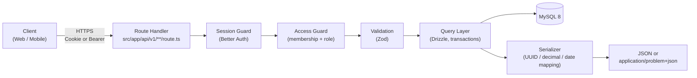

# API Planning

This directory contains the REST API design and endpoint specification for **Fortis Libertas**. It defines the resources, routes, request/response contracts, authorization rules, and cross-cutting conventions that sit on top of the database model documented in [`../db/`](../db), prior to and alongside implementation in [`src/app/api/`](../../../src/app/api).

---

## Directory Overview

```text
docs/planning/api/
|-- README.md       # API overview, architecture, conventions, and workflow (this file)
\-- endpoints.md    # Endpoint-level specification (routes, payloads, rules, errors)
```

---

## Contents & Documents

| Document | Purpose |
| -------- | ------- |
| **[`endpoints.md`](./endpoints.md)** | Complete endpoint reference: HTTP method, path, minimum role, request fields, response fields, business rules, and error codes for every resource. |
| **[`../db/data-dictionary.md`](../db/data-dictionary.md)** | Source of truth for field names, types, nullability, and constraints that request/response payloads are derived from. |
| **[`../db/model-er.md`](../db/model-er.md)** | Source of truth for relationships, cardinalities, and referential rules (`CASCADE`, `RESTRICT`, `SET NULL`) that the API must respect. |

---

## Technology Stack & Implementation Mapping

| Concern | Choice | Notes |
| :--- | :--- | :--- |
| **Framework** | [Next.js](https://nextjs.org) 16.x (App Router) | API implemented as [Route Handlers](https://nextjs.org/docs/app/getting-started/route-handlers) (`route.ts`). In Next.js 16, dynamic route `params` are a `Promise` and must be awaited. |
| **Language** | TypeScript (strict mode) | Shared types between route handlers, query layer, and validation schemas. |
| **ORM** | [Drizzle ORM](https://orm.drizzle.team) (latest) + `drizzle-kit` | Schemas in [`src/db/schema/`](../../../src/db/schema), queries in [`src/db/queries/`](../../../src/db/queries). |
| **Database** | MySQL 8.x via `mysql2` | Orchestrated with [Docker Compose](../../../docker-compose.yml). See [`../db/README.md`](../db/README.md). |
| **Authentication** | [Better Auth](https://www.better-auth.com/) | Cookie sessions for the web client; `bearer` plugin for mobile clients. |
| **Validation** | [Zod](https://zod.dev) *(proposed)* | One schema per request body / query string, colocated with the route. |
| **Runtime** | Node.js runtime for all handlers | Declare `export const runtime = "nodejs"`; `mysql2` is not Edge-compatible. |

> Exact dependency versions are intentionally not pinned in this document. Refer to `package.json` and the lockfile.

---

## Architecture

Every request passes through the same pipeline. Authorization is always evaluated **inside** the route handler (never only in `proxy.ts`, formerly `middleware.ts`).



### Proposed Code Structure

```text
src/
|-- app/api/
|   |-- auth/[...all]/route.ts            # Better Auth catch-all handler
|   \-- v1/
|       |-- me/                           # current user, profile, sessions, accounts, notifications
|       |-- bank-accounts/[bank_account_id]/
|       |-- cards/[card_id]/
|       \-- dashboards/[dashboard_id]/
|           |-- members/
|           |-- record-types/
|           |-- categories/
|           |-- tags/
|           |-- payment-methods/
|           |-- installment-plans/
|           |-- financial-records/
|           \-- reports/
|-- lib/api/
|   |-- auth.ts                           # requireSession()
|   |-- access.ts                         # requireDashboardRole(), requireBankAccountRole()
|   |-- errors.ts                         # ApiError, withErrors(), problem+json mapping
|   |-- responses.ts                      # ok(), created(), noContent(), paginated()
|   |-- pagination.ts                     # page / per_page parsing
|   |-- serializers/                      # DB row -> API representation
|   \-- schemas/                          # Zod request schemas
\-- db/                                   # existing: schema, migrations, seed, queries
```

> This layout is a proposal. File names under `lib/api/` are illustrative until implemented.

### Route Handler Example (Illustrative)

```ts
// src/app/api/v1/dashboards/[dashboard_id]/categories/route.ts
import type { NextRequest } from "next/server";
import { and, eq, isNull } from "drizzle-orm";
import { db } from "@/db";
import { category } from "@/db/schema";
import { requireDashboardRole } from "@/lib/api/access";
import { withErrors } from "@/lib/api/errors";
import { ok } from "@/lib/api/responses";
import { serializeCategory } from "@/lib/api/serializers/category";

export const runtime = "nodejs";

type Ctx = { params: Promise<{ dashboard_id: string }> };

export const GET = withErrors(async (request: NextRequest, { params }: Ctx) => {
  const { dashboard_id } = await params; // async params (Next.js 15+)
  await requireDashboardRole(request, dashboard_id, "viewer");

  const rows = await db
    .select()
    .from(category)
    .where(and(eq(category.dashboardId, dashboard_id), isNull(category.deletedAt)));

  return ok(rows.map(serializeCategory));
});
```

---

## API Conventions

Full details and examples are in [`endpoints.md`](./endpoints.md#1-conventions). Summary:

| Topic | Convention |
| :--- | :--- |
| **Base path** | `/api/v1`. Authentication endpoints live under `/api/auth` (Better Auth). |
| **Format** | JSON only (`application/json`). Errors use `application/problem+json` ([RFC 9457](https://www.rfc-editor.org/rfc/rfc9457)). |
| **Field naming** | `snake_case`, identical to the column names in [`data-dictionary.md`](../db/data-dictionary.md). The Drizzle `camelCase` properties are mapped in the serializer layer. |
| **Resource naming** | Plural, kebab-case nouns (`financial-records`, `payment-methods`). Dashboard-scoped resources are nested under `/dashboards/{dashboard_id}`. |
| **Identifiers** | Opaque UUID strings (v7). `binary(16)` columns are converted to and from the canonical 36-character form at the boundary. |
| **Money** | `decimal(10,2)` is serialized as a **string** (`"49.90"`) to avoid floating-point loss. |
| **Timestamps** | ISO 8601 in UTC (`2026-10-13T09:30:00.000Z`). `date` columns use `YYYY-MM-DD`. |
| **Soft delete** | `DELETE` on tables with `deleted_at` sets the timestamp and returns `204`. Soft-deleted rows are excluded from every read. |
| **Pagination** | `page` (default `1`) and `per_page` (default `25`, max `100`). Response includes a `meta` object. |
| **Concurrency** | Multi-table writes (e.g. dashboard + owner membership + seeded record types) run in a single Drizzle transaction. |
| **Versioning** | Breaking changes ship under a new prefix (`/api/v2`). Additive changes stay in `v1`. |

### Data Type Mapping

| Database Type | JSON Type | Example |
| :--- | :--- | :--- |
| `binary(16)` | `string` (UUID) | `"0199c3a2-7b1e-7d4a-9f3e-2a6b8c1d4e5f"` |
| `decimal(10,2)` | `string` | `"1249.90"` |
| `datetime` | `string` (ISO 8601 UTC) | `"2026-10-13T09:30:00.000Z"` |
| `date` | `string` (`YYYY-MM-DD`) | `"2026-12-31"` |
| `bool` | `boolean` | `true` |
| `int` | `number` | `12` |
| `enum` | `string` (literal union) | `"settled"` |
| `json` | `object` | `{ "record_id": "..." }` |
| `varchar` / `text` / `char` | `string` | `"Groceries"` |
| nullable column | value or `null` | `null` |

---

## Authentication & Authorization

### Authentication

Authentication is delegated to **Better Auth**. The API never implements its own credential handling.

| Client | Mechanism | Header / Transport |
| :--- | :--- | :--- |
| **Web (Next.js)** | Session cookie set by Better Auth | `Cookie: better-auth.session_token=...` (sent automatically) |
| **Mobile (Kotlin)** | Bearer token via the Better Auth `bearer` plugin | `Authorization: Bearer <session_token>` |

- Sign-up, sign-in, sign-out, social login, email verification, password reset, and two-factor flows are served by `/api/auth/*`. They are summarized in [`endpoints.md`](./endpoints.md#2-authentication-better-auth) but are **not** re-specified here.
- All `/api/v1/*` endpoints require a valid session. A missing or expired session returns `401`.
- A user with `User.suspended_at` set receives `403 ACCOUNT_SUSPENDED` on every `/api/v1/*` request. A user with `User.deleted_at` set is treated as unauthenticated.
- When a `User` row is created, a matching `Profile` row (1:1) must be created in the same transaction (via a Better Auth database hook), using the defaults `currency = EUR` and `language = pt-PT`.

### Authorization Model

Access is determined by **membership role**, not by global user roles. Roles are ranked `owner` > `editor` > `viewer`; a higher role inherits every permission of the lower ones.

| Scope | Membership Table | Resources Governed |
| :--- | :--- | :--- |
| **Dashboard** | `User__Dashboard` | `Dashboard`, `Record_Type`, `Category`, `Tag`, `Payment_Method`, `Installment_Plan`, `Financial_Record` and their junctions |
| **Bank account** | `Bank_Account__User` | `Bank_Account`, `Card` |
| **Self** | Session `user_id` | `User`, `Profile`, `Session`, `Account`, `Notifications` |

| Role | Capabilities |
| :--- | :--- |
| `viewer` | Read-only access to every resource in the scope. |
| `editor` | Create, update, and soft-delete operational data (records, categories, tags, payment methods, installment plans, cards). |
| `owner` | Everything an editor can do, plus manage members, rename/deactivate/delete the dashboard or bank account, and freeze/unfreeze bank accounts. |

**Existence hiding:** if the caller is not an active member of the requested scope, the API responds `404 NOT_FOUND` (not `403`), so resource identifiers cannot be enumerated.

**Cross-scope integrity:** every foreign key supplied in a request body (e.g. `category_id`, `payment_method_id`, `tag_ids`) must reference a non-deleted row that belongs to the **same dashboard** as the route. Otherwise the API returns `422 VALIDATION_ERROR`.

---

## Entity-to-Resource Mapping

Every table in the [data dictionary](../db/data-dictionary.md) is accounted for below.

| Table | Exposure | Base Path | Notes |
| :--- | :--- | :--- | :--- |
| `User` | Read / update self | `/api/v1/me` | Created by Better Auth sign-up. |
| `Profile` | Read / update self | `/api/v1/me/profile` | 1:1 with `User`. |
| `Session` | List / revoke own | `/api/v1/me/sessions` | Created by Better Auth. `token` is never returned. |
| `Account` | List own (metadata only) | `/api/v1/me/accounts` | Provider tokens and `password` are never returned. Link / unlink via Better Auth. |
| `Two_Factor` | Delegated | `/api/auth/two-factor/*` | `secret` and `backup_codes` are never exposed by `/api/v1`. |
| `Verification` | Internal only | n/a | Managed entirely by Better Auth. |
| `Notifications` | List / mark read / delete own | `/api/v1/me/notifications` | Created server-side only; no public `POST`. |
| `Bank_Account` | CRUD + freeze | `/api/v1/bank-accounts` | Scoped by `Bank_Account__User`. |
| `Bank_Account__User` | Member management | `/api/v1/bank-accounts/{bank_account_id}/members` | Hard delete (no `deleted_at`). |
| `Card` | CRUD + freeze | `/api/v1/bank-accounts/{bank_account_id}/cards`, `/api/v1/cards` | `card_number` is masked and `cvv` is write-only. |
| `Dashboard` | CRUD | `/api/v1/dashboards` | Creation seeds the default `Record_Type` rows. |
| `User__Dashboard` | Member management | `/api/v1/dashboards/{dashboard_id}/members` | Soft delete; re-adding reactivates the row. |
| `Record_Type` | CRUD | `/api/v1/dashboards/{dashboard_id}/record-types` | |
| `Category` | CRUD | `/api/v1/dashboards/{dashboard_id}/categories` | |
| `Tag` | CRUD | `/api/v1/dashboards/{dashboard_id}/tags` | |
| `Tag__Category` | Link management | `/api/v1/dashboards/{dashboard_id}/categories/{category_id}/tags` | Hard delete. |
| `Payment_Method` | CRUD | `/api/v1/dashboards/{dashboard_id}/payment-methods` | |
| `Installment_Plan` | CRUD | `/api/v1/dashboards/{dashboard_id}/installment-plans` | |
| `Financial_Record` | CRUD + filtering | `/api/v1/dashboards/{dashboard_id}/financial-records` | Central transactional resource. |
| `Tag__Financial_Record` | Link management | `/api/v1/dashboards/{dashboard_id}/financial-records/{financial_record_id}/tags` | Hard delete. |

---

## Security Considerations

- **Secrets are write-only or internal.** `Session.token`, `Account.access_token` / `refresh_token` / `id_token` / `password`, `Two_Factor.secret` / `backup_codes`, `Verification.value`, and `Card.cvv` never appear in any response.
- **Card data is masked.** Responses expose only `card_number_last4`. See [Open Item 6](#schema-notes--open-items).
- **Tenant isolation.** Every dashboard-scoped query filters by `dashboard_id` *and* verifies membership. Never trust a `dashboard_id` from the request body.
- **Server-controlled fields.** `register_by_id`, `user_id` (on create), `created_at`, `updated_at`, `deleted_at`, `frozen_at`, and `email_verified_at` cannot be set through request bodies; unknown keys are rejected.
- **Input validation.** All bodies and query strings are validated with strict schemas (`.strict()`); IDs are validated as UUIDs before reaching the database.
- **Rate limiting.** Authentication routes use Better Auth's built-in rate limiter. Write endpoints should return `429 RATE_LIMITED` with a `Retry-After` header once a limiter is added.
- **Logging.** Never log `Authorization` headers, cookies, card fields, or request bodies of `/api/auth/*`.

---

## Schema Notes & Open Items

Inconsistencies found while deriving the API from the database documentation. Each entry states the assumption the API currently makes.

| # | Source | Observation | API Assumption / Impact |
| :-: | :--- | :--- | :--- |
| 1 | `model-er.md` vs `data-dictionary.md` | `Payment_Method` PK is `char26` in the ER diagram but `binary(16)` in the dictionary. | Exposed as a UUID like every other ID. Align the ER diagram. |
| 2 | `model-er.md` vs `data-dictionary.md` | `Financial_Record` PK is `financial_record_id` in the ER diagram but `financial_id` in the dictionary. | API uses `financial_record_id`. Align the dictionary. |
| 3 | `data-dictionary.md` | `Payment_Method` unique constraint is described as `(dashboard_id, user_id, name)` but the index is `(dashboard_id, name)`; `model-er.md` says `(dashboard_id, name)`. | API returns `409 NAME_ALREADY_EXISTS` on whichever constraint is implemented. Decide whether names are unique per user or per dashboard. |
| 4 | `data-dictionary.md` | Unique indexes on `(dashboard_id, name)` do not exclude soft-deleted rows. | A name used by a soft-deleted row still returns `409 NAME_ALREADY_EXISTS`. A restore endpoint is **out of scope for v1**; consider a generated column or a purge job. |
| 5 | `data-dictionary.md` | `Two_Factor.tow_factor_id` (typo), `Account.account_identifier_id` vs `account_id` in the ER diagram, and `PRIMARY KEY (id)` in index lists. | Cosmetic; these tables are internal to Better Auth, so no API impact. |
| 6 | `data-dictionary.md` | `Card.card_number` (`char(16)`) and `Card.cvv` (`char(3)`) are stored as plain text. Retaining a CVV after authorization is prohibited by PCI DSS. | API never returns `cvv` or the full `card_number`. Recommend storing only the last four digits (or a processor token) and dropping `cvv`. |
| 7 | `data-dictionary.md` | `Financial_Record.status` has no default value. | `status` is required on create. |
| 8 | `model-er.md` | Referential rules (`CASCADE`, `RESTRICT`, `SET NULL`) describe physical deletes, but most tables use soft delete. | The API emulates `RESTRICT` with `409 IN_USE` and `SET NULL` by explicit updates inside the delete transaction. Physical `CASCADE` applies only to purge jobs. |

---

## Workflow & Guidelines

When adding or modifying an endpoint:

1. **Update the database docs first** if the change touches the schema ([`../db/README.md`](../db/README.md) describes that workflow).
2. **Specify the endpoint** in [`endpoints.md`](./endpoints.md): method, path, minimum role, request fields, response fields, business rules, and error codes.
3. **Implement the Zod schema** and the route handler under `src/app/api/v1/`.
4. **Reuse the query layer** in [`src/db/queries/`](../../../src/db/queries); route handlers should not contain raw table joins.
5. **Wrap multi-table writes in a transaction.**
6. **Never introduce a breaking change in `v1`.** Removing or renaming a field, tightening validation, or changing a status code requires a new version prefix.

### Related Commands

| Command | Description |
| ------- | ----------- |
| `bun run dev` | Start the Next.js development server (API available at `http://localhost:3000/api`) |
| `bun run build` | Create a production build |
| `bun run start` | Serve the production build |
| `docker compose up -d` | Start the local MySQL database and phpMyAdmin containers |
| `bun run db:push` / `db:generate` / `db:migrate` | Apply schema changes (see [`../db/README.md`](../db/README.md)) |
| `bun run db:seed` | Seed development data |
